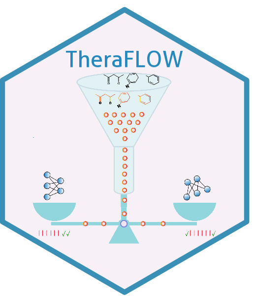
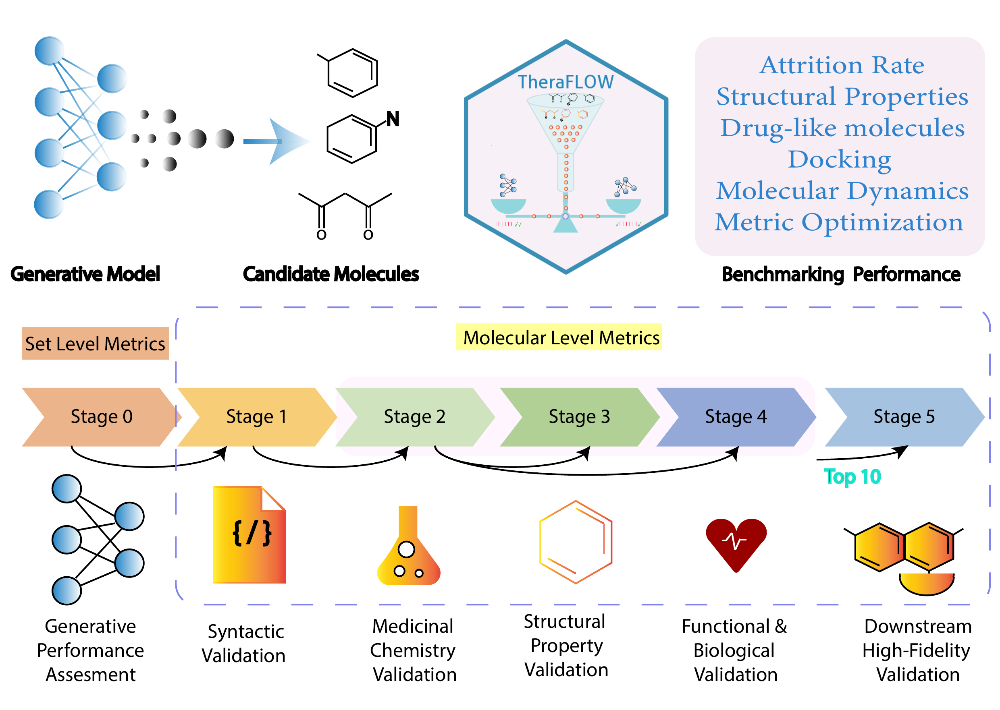

# TheraFlow 

[](https://www.python.org/)
[](https://www.r-project.org/)
[](https://opensource.org/licenses/MIT)
[](https://github.com/google-deepmind/alphafold3)
[](https://github.com/grimme-lab/xtb)

**TheraFlow** is a staged evaluation framework that mirrors early drug-discovery screening by progressively filtering and prioritising candidate molecules. TheraFlow integrates more than 70 complementary performance endpoints spanning generative quality, physicochemical properties, structural feasibility, disease-signature reversal, and downstream structural behaviour through AlphaFold3-guided docking and xTB-based molecular dynamics.

---

<p align="center">
  
  <br>
  <em>Evaluation Framework: <a href="www/Figure2a.pdf">Figure2a.pdf</a>)</em>
</p>

---

## 🏗️ Architecture & Pipeline Stages

1. **Stage 1: Generative Performance & Distributional Metrics (`1.generative_perf.py`)**  
   Computes syntax validity, uniqueness, MOSES novelty against reference databases, and internal structural diversity across generated libraries.
2. **Stage 2: 2D Physicochemical Descriptors & Safety Alerts (`2.molecular_properties.py`)**  
   Calculates MW, LogP, TPSA, QED, Synthetic Accessibility (SA Score), F_Csp3, and screens against PAINS, BRENK, and NIH structural toxicity alerts.
3. **Stage 3: 3D Conformer Generation & PoseBusters Validation (`3.posebuster_convert_sdf.py`)**  
   Generates ETKDGv3 energy-minimized 3D conformers and runs PoseBusters to evaluate stereochemical integrity, bond lengths, valence angles, and steric clashes.
5. **Stage 4: DTSEA Transcriptomic Disease Reversal (`4.potency_chembl.py` / `5.disease_reversal.py` / `disease_reversal.R`)**  
   Weights drug-target perturbations on the human protein-protein interaction (PPI) network to calculate Drug-Target Set Enrichment Analysis (DTSEA) Normalized Enrichment Scores (NES) against disease differential signatures.
6. **Stage 5: AlphaFold 3 Batch Neural Docking & GFN2-xTB QM Analysis (`6.docking_md.py`)**  
   - Predicts 3D target-ligand complex co-folded structures using AlphaFold 3 across parallel GPUs.
   - Extracts active site binding pockets (4.0-5.0 Å) via `take_interface.py`.
   - Runs semi-empirical GFN2-xTB calculations across 16 CPU cores to derive quantum chemical descriptors (HOMO-LUMO gap, total dipole moment, SCF energy, Wiberg bond orders, pocket RMSD).


---

## 🔬 Benchmark Generative Methods & Datasets

### Generative Architectures Evaluated (10 Methods):
| Method | Representation | Architecture / Paradigm |
|---|---|---|
| **SmilesGEN** | SMILES | Reinforcement Learning & RNN |
| **BiAAE** | SMILES | Bidirectional Adversarial Autoencoder |
| **BiCEV** | SMILES | Conditional Variational Autoencoder |
| **Paccmann RL** | SMILES | Multimodal Reinforcement Learning |
| **GxRNN** | SMILES | Expression-Conditioned Recurrent Neural Network |
| **TransGEM** | SMILES | Transformer-based Expression-to-Molecule Decoder |
| **TRIOMPHE** | SELFIES | Transcriptome-conditioned Deep Generator |
| **FAME** | SELFIES | Feature-Augmented Molecular Exploration |
| **Gex2SGen** | SELFIES | Gene Expression to SELFIES Sequence Model |
| **gexmolgen** | SMILES | Conditional Generative Diffusion & Language Framework |

### Benchmark Disease Datasets:
1. **Cardiomyopathy** (`cardiomyopathy`): Dilated cardiomyopathy differential expression (Target: TTN / MYH7).
2. **Glaucoma** (`glaucoma` & `glaucoma_bulk`): Primary open-angle glaucoma trabecular meshwork & bulk RNA-seq (Target: PTGFR).
3. **HCC** (`hcc`): Hepatocellular carcinoma tumor vs. normal differential profile (Target: VEGFR2 / KDR).
4. **Parkinson's** (`parkinsons`): Parkinson's disease substantia nigra profile (Target: SNCA).
5. **Control Datasets** (`lincs1000_1`, `lincs1000_2`): LINCS L1000 landmark perturbation signatures.


> [!NOTE]
> **Upstream Dataset Preprocessing & Generative Methods Execution**:
> If running the upstream generation pipeline from scratch:
> 
> 1. **Clone external model repositories into parent directory alongside `TheraFlow`**:
>    ```bash
>    git clone https://github.com/hliulab/SmilesGEN.git
>    git clone https://github.com/insilicomedicine/BiAAE.git
>    git clone https://github.com/ChemEXL/BiCEV.git
>    git clone https://github.com/PaccMann/paccmann_rl.git
>    git clone https://github.com/hzauzqy/TransGEM.git
>    git clone https://github.com/Bunnybeibei/GexMolGen.git
>    # GxRNN & Triomphe: Download from official web servers
>    # FAME & GEx2SGen: Fully self-contained in TheraFlow/method_processing/
>    ```
> 
> 2. **Preprocess raw disease signatures & align landmark genes**:
>    ```bash
>    python TheraFlow/method_processing/dataset_processing.py
>    ```
> 
> 3. **Run generative models across test datasets**:
>    ```bash
>    python TheraFlow/method_processing/smilesgen.py --run-all
>    python TheraFlow/method_processing/biaee.py --run-all
>    python TheraFlow/method_processing/bicev.py --run-all
>    python TheraFlow/method_processing/gxrnn.py --run-all
>    python TheraFlow/method_processing/transgem.py --run-all
>    python TheraFlow/method_processing/triomphe.py --run-all
>    python TheraFlow/method_processing/fame.py --run-all
>    python TheraFlow/method_processing/gex2sgen.py --run-all
>    python TheraFlow/method_processing/paccmann_rl.py --run-all
>    ```
> 
> 4. **Combine generated molecules into `processed_data.csv`**:
>    ```bash
>    python TheraFlow/method_processing/combine.py
>    ```
---

## 🚀 Quick Execution

### 1. Run Complete End-to-End Evaluation Pipeline
```bash
python TheraFlow/run_pipeline.py   --input TheraFlow/method_processing/data/processed_data.csv   --output_dir TheraFlow/outputs
```

### 2. Launch Interactive TheraFlow Dashboard and Agent
```bash
Rscript -e 'shiny::runApp("TheraFlow")'
```

---

## 📊 Outputs & Data Directory Structure

All generated results are organized under `TheraFlow/outputs/`:

| Output File | Description |
|---|---|
| `set_properties.csv` | Distributional quality metrics (Validity, Uniqueness, Novelty, Diversity). |
| `molecular_properties_metrics.csv` | 2D Physicochemical descriptors, SA score, QED, PAINS/BRENK/NIH alerts. |
| `filtered_3d.sdf` | Energy-minimized 3D molecular conformations. |
| `molecular_properties_with_posebusters.csv` | Deduplicated dataset with PoseBusters physical validity flags. |
| `chembl_targets.csv` | Matched ChEMBL analog compounds, target genes, and mechanism of action. |
| `potency_scores.csv` | Retrieved experimental bioactivity metrics (IC50, pChEMBL). |
| `reversal_res.csv` | DTSEA disease DEG reversal scores (Enrichment Score, NES, p-values). |
| `consensus_top.csv` | Top prioritized candidate molecules per method and disease from Pareto/RRA ranking. |
| `af3_batch_input.json` | AlphaFold 3 batch input specifications for target-ligand complexes. |
| `docking_qm_metrics.csv` | AlphaFold 3 confidence scores and GFN2-xTB quantum descriptors. |
| `merged_master_dataframe.csv` | Unified master table combining all 100+ metrics across the entire molecule collection. |
